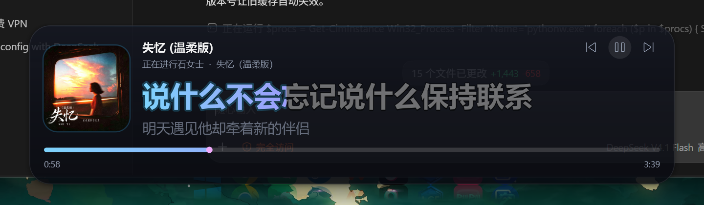
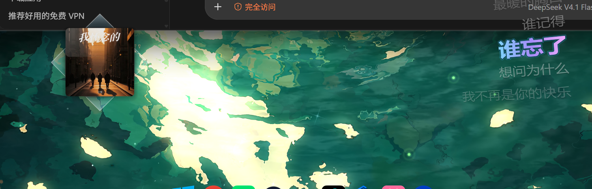
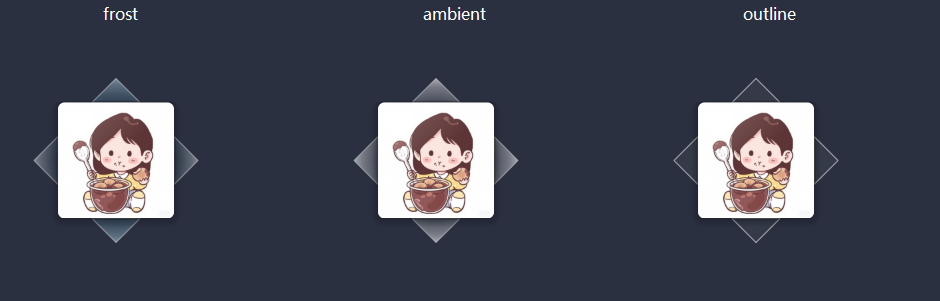

# 桌面歌词 (LyricDesk)

> GitHub 仓库（镜像）：<https://github.com/stuate-jz/LyricDesk>　·　发布页：<https://stuate-jz.github.io/LyricDesk/>

把正在播放的歌词实时显示在桌面上的悬浮组件，带逐字卡拉OK 动画，
同时显示专辑封面、歌名、歌手、播放进度与播放控制。

**不挑播放器**：读取的是 Windows 系统媒体控制（SMTC），任何向系统报告
播放状态的播放器都能用——QQ音乐、酷狗音乐、网易云音乐、酷我音乐、
Spotify、PotPlayer、foobar2000 等。同时开多个时可以右键指定跟随哪一个。

首次启动默认使用**立体卡片**模式（封面方块 + 四个磨砂三角 + 向内倾斜的歌词列表）。



立体卡片模式：



## 启动

> 发布页文件在 `release-page/`（Gitee 用）；GitHub Pages 用的那份在 `docs/`。
> 发版脚本与同步脚本放在开发机的 `dev\` 目录，属于本机工具，不随仓库发布。

源码方式启动：

```
pythonw run.pyw
```

（开发机上也可以用 `dev\start.vbs`，它只是把上面这条命令藏掉控制台窗口；
出错时跑 `dev\debug.bat` 能看到具体报错。）

## 用法

| 操作 | 说明 |
| --- | --- |
| 左键拖动 | 移动窗口到任意位置（位置会自动记住） |
| 单击封面左侧区域 | 直接拖动，不会误触按钮 |
| ⏮ ⏯ ⏭ | 上一首 / 播放暂停 / 下一首 |
| 拖动进度条 | 跳转到指定位置 |
| 右键 | 打开常用操作菜单（完整设置在「设置…」里） |
| 双击空白处 | 锁定 / 解锁位置（锁定后不能拖动） |

## 设置窗口

右键歌词窗口或托盘图标 → **设置…**（快捷键 `Ctrl + ,`），打开一份正经的设置界面：
左边是分类，右边是可滚动的设置项，**改动即时生效**，不用点确定、也不用重启。

分类一共五个：**界面 / 歌词 / 播放 / 窗口与交互 / 更新与关于**。

几个容易忽略的点：

- **设置窗口默认不置顶**（切到浏览器、资源管理器它就正常被盖住）；
  想让它一直浮在最上面，勾右上角的「置顶显示」。
- **打开设置窗口时会临时把歌词窗的置顶摘掉**（不然置顶的歌词会画在设置窗口上面、
   挡着点不动），关掉设置窗口自动恢复原样；设置里存的那个「置顶显示」值不会变。
- **设置窗口外观**可以选「跟随歌词主题 / 深色 / 浅色」；
- **界面语言**支持「跟随系统 / 中文 / English」（在「更新与关于」里），
  设置窗口里的文字会立刻切换；
- 「窗口与交互」里有一张**快捷键表**，把常用操作列全了。
- **每个主题都有专属的设置窗口配色**（极光偏青紫、樱花偏暖粉、落日偏琥珀、
  青竹偏青绿、素白是极简无彩），窗口顶部还有一条主题色标题带，一眼能看出现在用的是哪个主题；
- 「更新与关于」里有**发布页网址**（跟着当前更新源走），点一下就用默认浏览器打开，
  底下还有一行项目主页，同样可点。

「界面」分类里的这些项都是**可以自由拖动的滑动条**，拖着就能看到桌面歌词实时变化：

| 设置项 | 范围 | 说明 |
| --- | --- | --- |
| 上下倾斜 | −0.80 ~ +0.80 | 正值「上窄下宽」、负值「下窄上宽」 |
| 左右倾斜 | −0.80 ~ +0.80 | 正值「左窄右宽」、负值「右窄左宽」（默认 +0.32） |
| 整体旋转 | −90° ~ +90° | 正值顺时针、负值逆时针 |
| 封面大小 | 40 ~ 320 px | 立体卡片的封面方块、唱片播放器的唱片 |
| 窗口宽度 | 240 ~ 2560 px | 歌词那一列有多长 |
| 歌词字号 | 12 ~ 200 px | |
| 歌词列表行数 | 1 ~ 15 行 | |
| 歌词行间距 | 0.50 ~ 3.00 倍 | |
| 整体不透明度 | 5% ~ 100% | 只作用于桌面歌词，设置窗口本身不受影响 |

双击任意一项的标题就能把它恢复成默认值；每条滑动条右边的数值框可以直接输入精确数字。

文字立体：上下倾斜 / 左右倾斜可以同时生效（两个方向都拉满时文字平面像朝一个角倒过去），
再叠上整体旋转可以做出各种角度；窗口会按当前参数自动多留一圈透明余量，所以拉到最大也不会被裁掉。


其余分类：主题 / 界面模式 / 专辑样式、歌词字体（内置、导入 ttf·otf、从系统字体中选择）、
歌词排版、歌词同步偏移、跟随哪个播放器、唱片面板的封面与进度条、锁定位置 / 鼠标穿透 / 置顶、
开机自启、检查更新、打开设置 / 缓存文件夹。

底部「恢复默认」会把外观设置恢复出厂，但**保留**窗口位置、每首歌单独调过的歌词偏移和更新源。

> 原来挤在右键菜单里的 12 项（歌词排版、上下倾斜、左右倾斜、整体旋转、主题、歌词字号、
> 封面大小、歌词字间距、歌词行间距、整体不透明度、打开音乐软件时自动显示歌词、开机自启）
> 已经全部搬进设置窗口，菜单只留常用操作。

## 右键菜单（常用操作）

- **界面模式**：唱片播放器（无歌词） / 纯歌词面板 / 立体卡片 / 分离面板
  - **唱片**：圆形黑胶（播放时旋转，封面印在中央）/ 方形封面 + 唱片，
    右侧是歌名、歌手、音频跳动波形、进度条与播放控制
  - **纯歌词面板**：立体卡片去掉左边的专辑，只剩右边那列歌词，
    同样透明、没有背景板；一样可以上下/左右倾斜、整体旋转
  - **立体卡片**：去掉整块背景，左边是专辑方块（后方叠一个旋转 45° 的淡化方块，
    只露出四个小三角），右边是向内倾斜的歌词列表，当前句渐变高亮
  - **分离面板**：唱片播放器和纯歌词面板同时出现，两扇窗口各自独立，
    可以分别拖到桌面任意位置并分别记住位置；第一次进入时唱片面板默认落在
    桌面右上角、歌词面板紧贴在它下面
- **设置…**：打开设置窗口（`Ctrl + ,`）
- **专辑样式**（仅立体卡片，只影响左侧封面区，右侧歌词不变）：
  经典（方块+菱形）/ 黑胶唱片（带唱臂）/ 封面+唱片


- **歌词列表行数**：1 / 3 / 5 / 7 / 9 / 11 行（想更细就在设置窗口里拖滑动条，1 ~ 15 行）
- **歌词字体**：内置「得意黑」「霞鹜漫黑」（随程序打包，装上就能用、不用联网）/
  导入自己的 ttf·otf 字体 / 从系统字体中选择 / 打开字体文件夹
- **跟随播放器**：检测到多个音乐软件时，指定跟随哪一个（默认自动选正在播放的）
- **播放控制（极简图标）**：菜单里**一行三个图标** —— 上一首 / 播放暂停 / 下一首，
  点一下直接控制当前播放器；图标跟着播放状态变（在播时是暂停图标），
  没在播歌时是灰的。桌面上不会有任何播放控件，适合把「显示播放控制」关掉、
  只想用菜单控制的人
- **歌词同步**：本歌提前 / 延后 0.1 / 0.5 / 1 秒，也可以填自定义毫秒数
  （偏移按「播放器 + 歌名 + 歌手 + 时长」分别记，调好一首不影响别的歌）
- **检查更新**：更新源已内置为项目自己的 Gitee 仓库，启动时静默自查
  （24 小时一次），发现新版本才提醒；点「立即更新」会自动下载安装并重开。
  万一以后仓库搬家，检查失败时弹出的窗口里可以重新指定更新源。
- **锁定位置、鼠标穿透、置顶显示**
  - 开启鼠标穿透会同时锁定位置；关闭则恢复可拖动
  - **Ctrl + Alt + L** 可随时切换鼠标穿透（托盘图标被系统折叠时的救急键）
- **最小化到托盘**：只保留托盘图标，程序继续在后台运行
- **重新获取歌词**：忽略缓存重新抓一次
- **回到默认位置**：把窗口放回默认位置（分离面板两扇窗口各自回到右上角那一列）
- **开机自启**：在设置窗口的「更新与关于」里，写入当前用户注册表 Run 项

> 唱片样式、显示封面 / 进度条 / 播放控制这几项也在设置窗口的「播放」分类里，
> 右键菜单不再重复放一份。

## 工作原理

1. 通过 Windows 系统媒体控制接口（SMTC）读取播放状态，**不挑播放器**。
    多设备/多播放器时按「用户指定 > 正在播放」排序挑一个。
    播放器的时间轴约每秒刷新一次，程序只在采样真正变化时重新锚定，
    两次采样之间用本地单调时钟外推，所以歌词是平滑推进而不是一秒一跳。
2. 按「歌名 + 歌手」在多个曲库里匹配最接近的一首（标题、歌手、时长三项打分）：
   依次尝试 **QQ音乐 → 酷狗 → 网易云**，哪家匹配最好用哪家，
    都不合适时用开放的 LRCLIB 兜底，再取回带时间轴的歌词。
3. 忽略歌词开头的署名行（作词/作曲/录音/版权方等写法很多，按关键词 + 冒号规则过滤）。
4. 逐字填充：在当前行的时间区间内按字符数平滑插值，
    用渐变高亮裁切实现卡拉OK 效果。
5. 封面优先用曲库的高清图；曲库没有时用系统媒体信息里自带的封面，
    这一步对任何播放器都有效。

## 文件位置

- 设置：`%APPDATA%\LyricDesk\settings.json`
- 歌词缓存：`%APPDATA%\LyricDesk\cache\`
- 封面缓存：`%APPDATA%\LyricDesk\covers\`

删掉 `%APPDATA%\LyricDesk` 即可完全重置。

## 依赖

```
pip install --user PySide6-Essentials winrt-runtime winrt-Windows.Foundation ^
    winrt-Windows.Foundation.Collections winrt-Windows.Media.Control ^
    winrt-Windows.Storage.Streams requests
```

## 改完代码，让桌面上的程序立刻生效（开发用）

桌面上的程序是**打包后的 exe**，改源码不会自动生效 —— 必须重新打包并覆盖安装目录。
手动三步：

1. 结束正在运行的桌面歌词（托盘退出 / 任务管理器），避开 exe 占用和单实例检查；
2. `python -m PyInstaller desktop-lyric.spec --noconfirm` 重新打包；
3. 把 `dist\LyricDesk.exe` 覆盖到 `%LOCALAPPDATA%\Programs\LyricDesk\LyricDesk.exe`，再启动。

`%APPDATA%\LyricDesk` 里的设置、导入的字体、歌词缓存都不会被动。

> 开发机上有一个把这三步包起来的 `dev\deploy_local.ps1`（还有 `-SkipBuild` /
> `-Source` / `-NoRestart` 三个开关），它和 `dev\` 里其它脚本一样是本机工具，不在仓库内。

## 打包成独立程序（发给别人用，对方不需要装 Python）

```
python -m PyInstaller desktop-lyric.spec --noconfirm
```

（改过图标才需要重新生成 `desktop-lyric.ico`，用本机 `dev\make_icon.py`，不在仓库内。）

默认输出**单文件** `dist\LyricDesk.exe`，约 39 MB，双击即可运行。

想要启动更快的文件夹版（不用每次解压），先设置环境变量 `LD_ONEFILE=0`
再执行同一条命令，输出在 `dist\LyricDesk\`。

想直接分发给朋友：把 `dist\LyricDesk.exe` 和 `packaging\` 里的三个说明文件一起给出去即可
（免安装，双击就能跑）。

## 做成双击安装的安装包（推荐：Inno Setup）

安装 Inno Setup 7（官方安装包自带简体中文语言包，不需要另外下翻译），
然后用它的编译器打包：

```
"%LOCALAPPDATA%\Programs\Inno Setup 7\ISCC.exe" installer.iss
```

输出 `dist\LyricDesk-Setup-v1.0.exe`（约 **44.6 MB**），双击即可安装：

- 标准安装向导：欢迎 → **许可协议**（需同意才放行）→ 更新说明 → 选择位置 →
  附加任务 → 安装中 → 完成
- 安装到 `%LOCALAPPDATA%\Programs\LyricDesk`，**不需要管理员权限**（不弹 UAC）
- 可选任务：创建桌面快捷方式、开机自动运行
- 注册到「设置 → 应用 → 已安装的应用」，卸载由 Inno 生成的卸载器负责
- 安装时若程序正在运行，会自动提示关闭（Restart Manager）
- 卸载时会询问是否同时删除设置和歌词缓存（静默卸载一律保留）
- 命令行：`/VERYSILENT /SUPPRESSMSGBOXES /NORESTART /SP- /TASKS="desktopicon"`

装好后占用约 **42.8 MB**（程序 38.6 MB + 卸载器 4.2 MB）。

许可协议正文在 `packaging\许可协议.txt`，改完重新编译即可生效。

> 注意：`installer.iss` 必须保存为 **UTF-8 带 BOM**，否则中文会乱码。

### 备用方案（不想装 Inno Setup 时）

```
python -m PyInstaller installer.spec --noconfirm
```

用项目里自带的 Python 安装器，功能一样（协议页、快捷方式、开机自启、
注册到应用和功能、静默安装 `/S`），只是体积大一倍：安装包 73 MB。

打包版与源码版共用同一份配置（`%APPDATA%\LyricDesk`）。

## 说明

- 需要 Windows 10 1809 以上（本项目在 Windows 11 上开发测试）。
- 只有在播放器向系统上报媒体信息时才能读取，QQ音乐 支持该接口。
  其他播放器（网易云、Spotify 等）通常也可以，会优先选择 QQ音乐。
- QQ音乐 的逐字 QRC 歌词需要登录态才能获取，因此这里使用逐行时间轴
  + 行内插值，视觉效果一致。
