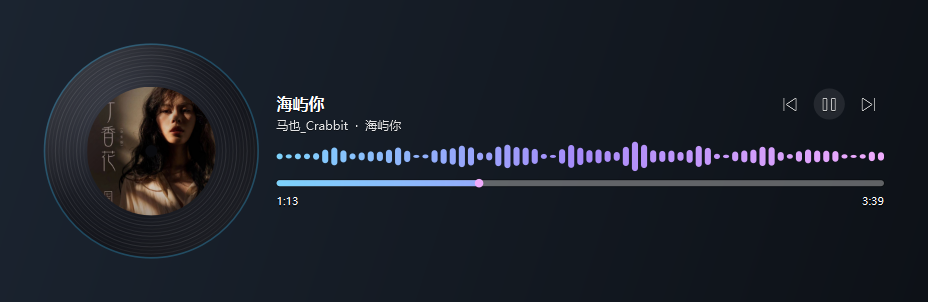
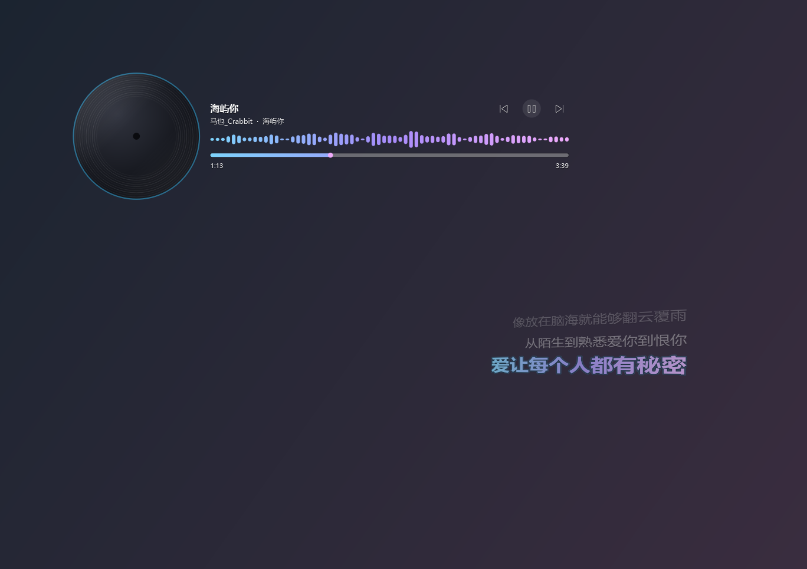

<!-- 这个文件是发布页，直接改内容重新提交即可 -->

<div align="center">


<h1>桌面歌词 LyricDesk</h1>

**悬浮在桌面上的歌词组件** —— 不挑播放器，带歌词跳动动画，不改你的壁纸

**当前版本 v1.6.5**　·　[⬇ 下载最新版](https://gitee.com/pursue-studies/LyricDesk/releases)　·　[全部版本](https://gitee.com/pursue-studies/LyricDesk/releases)

镜像仓库：[GitHub](https://github.com/stuate-jz/LyricDesk)　·　发布页：[stuate-jz.github.io/LyricDesk](https://stuate-jz.github.io/LyricDesk/)

</div>

---

## ⬇ 下载

### ⚙ [**桌面歌词-安装程序-v1.6.5.exe**](https://gitee.com/pursue-studies/LyricDesk/releases)

双击一路「下一步」装好即可（不需要管理员权限，不需要改任何系统设置）。

**以后升级不用再手动下载**：程序自带检查更新，发现新版本会在托盘提醒，
点一下「立即更新」就会自动下载、安装并重新打开。

> 文件在 [**Releases 页面**](https://gitee.com/pursue-studies/LyricDesk/releases) 的附件里。

---

支持任何向 Windows 报告播放状态的播放器：QQ音乐、酷狗音乐、网易云音乐、
酷我音乐、Spotify、PotPlayer、foobar2000 等；同时开多个可以右键指定跟随哪一个。

## 这个版本更新了什么

- 新增：设置界面「更新与关于」里加入发布页网址，点开即可看更新动态
- 新增：每个主题都有专属的设置界面配色（极光/樱花/落日/青竹/素白 各不相同）
- 变更：去掉「显示上一首按钮 / 显示下一首按钮」两个开关，统一由「显示播放控制」控制
- 优化：设置界面主题色标题带与选中态，主题切换一眼可辨

## 四种界面

| 界面 | 样子 | 适合 |
| --- | --- | --- |
| 立体卡片 | 左边专辑、右边歌词，文字向内倾斜 | 默认，最好看 |
| 唱片播放器 | 唱片 + 曲名 / 歌手 / 频谱 / 进度条 / 切歌 | 想要个桌面播放器 |
| 纯歌词面板 | 只有歌词，透明浮在壁纸上 | 极简 |
| 分离面板 | 唱片和歌词是两扇独立窗口，各拖各的 | 想自己摆位置 |





## 怎么用

1. 下载上面的安装程序，双击，一路「下一步」装好（不需要管理员权限）
2. 装完程序会自己启动，并缩到右下角托盘，桌面上出现歌词
3. 打开任意音乐软件放歌，歌词自动跟上
4. 左键拖动摆位置；**右键是常用操作**（界面模式、字体、行数、锁定、播放控制…），
   完整的设置（配色、倾斜、尺寸、语言…）在右键菜单最后的 **「设置…」** 里

想换字体：右键 → 歌词字体 —— 内置了「得意黑」「霞鹜漫黑」，
也可以用「导入字体文件…」把自己下载的 ttf / otf 字体导进来，导入一次以后一直在。

卸载：开始菜单 → 桌面歌词 → 卸载，或者「设置 → 应用」里卸载。

## 常见问题

**桌面显示「未检测到正在播放的歌曲」？**
不少音乐软件的「系统播放控件 / 媒体控制」默认是关的，关掉之后 Windows 里
没有任何播放信息，任何歌词插件都读不到。到音乐软件设置里打开它即可：
网易云 → 设置 → 常规 → 系统媒体控制；酷狗、QQ音乐 等也有类似开关。

**怎么退出？**
右键桌面上的歌词 → 最小化到托盘，程序仍在后台；彻底退出请右键右下角的
音符图标 → 退出。托盘图标可能被收进「^」溢出区。

**鼠标穿透之后点不动了？**
按 `Ctrl + Alt + L` 随时开关，也可以右键托盘图标解除。

**为什么杀毒软件会提示？**
这是 Python 打包的程序，部分杀软对这类自解压程序会误报；
程序只从公开曲库读取歌词和封面，不上传任何个人数据。

**以后怎么升级？**
程序自带检查更新：右键 → **设置… → 更新与关于 → 设置更新源…**，把下面这行填进去：

```
gitee:pursue-studies/LyricDesk
```

填好之后每次启动会自动检查一次，有新版本会发托盘通知；
也可以随时在菜单里点「检查更新…」手动查。

## 系统要求

- Windows 10 1809 或更高（Win11 最佳）
- 需要能上网（用于获取歌词与专辑封面）

## 许可

免费使用。内置字体「得意黑」「霞鹜漫黑」均为 SIL OFL 1.1 授权，可自由分发。
